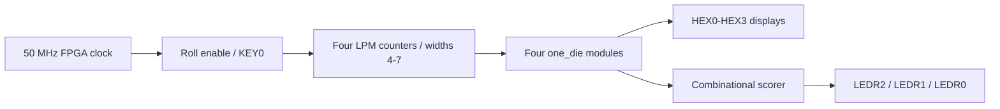

# FPGA Digital Design in VHDL: LFSR and Four-Dice Game

**NJIT ECE 495 | Experiment 5 | Intel Quartus Prime | Terasic DE2-115**

A collection of FPGA digital-logic designs exploring parameterized VHDL,
structural hardware design, counter architectures, seven-segment decoding,
and user-controlled FPGA interfaces.

Experiment 5 has two sections:

- **Part A, LFSR:** A generically sized linear-feedback shift register whose
  hexadecimal state is displayed on the board LCD. The assignment is
  documented here; the original LFSR and LCD implementation files have not
  been supplied yet.
- **Part B, Dice Game:** A four-dice electronic game using independent count
  divisions, six-state dice counters, seven-segment displays, and scoring LEDs.
  VHDL for the top-level, four-dice, one-die, and decoder modules has been
  transcribed from screenshots of the implementation.

## Part B demonstration: how it works

Pressing the board's **active-low `KEY(0)`** enables the roll clock. Four
`lpm_counter` blocks have different widths (4, 5, 6, and 7 bits) and feed
their most significant bits to four `one_die` instances. Each instance
combines a **1-to-6 counter** with a **seven-segment decoder**.

The output of each die goes to `HEX0` through `HEX3`. Those same 3-bit values
feed the `scorer`, which drives the three LEDs:

| LED | Combination | Example |
| --- | --- | --- |
| `LEDR(2)` | Four of a kind | `3, 3, 3, 3` |
| `LEDR(1)` | Exactly three of a kind | `4, 4, 4, 1` |
| `LEDR(0)` | Two distinct pairs | `2, 5, 2, 5` |

The combinations are mutually exclusive. With no matching combination,
all three indicator outputs are low.



### Modulus-6 schematic

The original lab design used three T flip-flops and logic gates in the Quartus
schematic editor. The following is a screenshot of the schematic supplied
with the code images:


## Source layout

```text
fpga-vhdl-lfsr-dice-game/
├── README.md
├── .gitignore
├── docs/
│   ├── architecture.md
│   ├── hardware-and-pinout.md
│   ├── verification.md
│   ├── setup.md
│   └── source-notes.md
├── part-a-lfsr/
│   ├── rtl/
│   ├── quartus/
│   └── simulation/
├── part-b-dice-game/
│   ├── rtl/
│   │   ├── lab_5b.vhd
│   │   ├── four_dice.vhd
│   │   ├── one_die.vhd
│   │   ├── die_decoder.vhd
│   │   ├── counter_1to6.vhd
│   │   └── scorer.vhd
│   ├── simulation/
│   │   ├── tb_scorer.vhd
│   │   ├── tb_die_decoder.vhd
    │   │   ├── tb_counter_1to6.vhd
│   │   └── run_ghdl.sh
│   └── quartus/
└── media/
    ├── mod6-counter-schematic.png
    └── source-screenshots/
```

## Getting started (Part B)

1. Create a Quartus project targeting the FPGA device on the DE2-115 board.
2. Add all `.vhd` files from [`part-b-dice-game/rtl/`](part-b-dice-game/rtl/).
3. Set **`lab_5b`** as the top-level entity.
4. Use the board-specific pin assignments from your existing `.qsf` file.
5. Compile the design and program the board.

`four_dice.vhd` depends on Intel's `lpm_counter` library in Quartus. The
structural `one_die.vhd` expects a component called `counter_1to6`.
A **behavioral replacement** is included to make that interface available
from source. If you have the original Quartus `.bdf`, add it to the project
and use it **instead** of the behavioral replacement, not both.

The scorer source wasn't visible in the uploaded screenshots, so
`scorer.vhd` is an **independently written implementation** of the documented
scoring rules. See [source notes](docs/source-notes.md) for full provenance.

### Test the portable modules

If [GHDL](https://github.com/ghdl/ghdl) is installed, run:

```bash
bash part-b-dice-game/simulation/run_ghdl.sh
```

This tests the scorer, display decoder, and behavioral six-state counter. The full design uses Intel
`lpm_counter` blocks, so Quartus simulation/compilation requires the vendor
environment. The test scripts have not been run in this repository's
creation environment.

## Engineering concepts

- Structural VHDL using component declarations, instantiation, and port maps
- Modular design with separate counter, decoder, die, and scoring components
- Clock division through distinct counter-width outputs
- Digital logic design using T flip-flops and schematic-entry tools
- Pushbutton, seven-segment display, and LED hardware interfacing
- Generic-driven sizing and LCD integration in Part A's assignment

## Project sources and documentation

The project is based on the author's Experiment 5 materials and submitted
source screenshots. The original lab handouts are not redistributed.
**Part A RTL, the original scorer source, the editable `.bdf`, and the
original `.qsf` pin file have not yet been uploaded.** See
[`docs/source-notes.md`](docs/source-notes.md) and
[`docs/setup.md`](docs/setup.md) for the exact file inventory.
